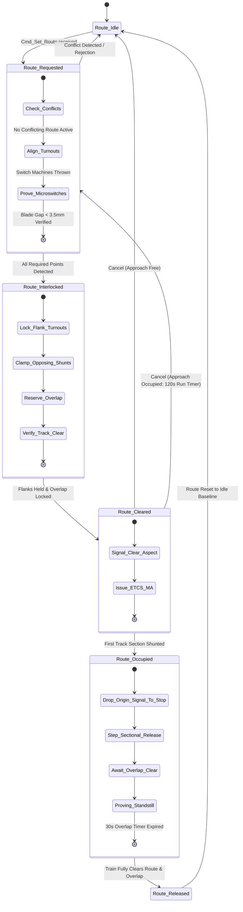
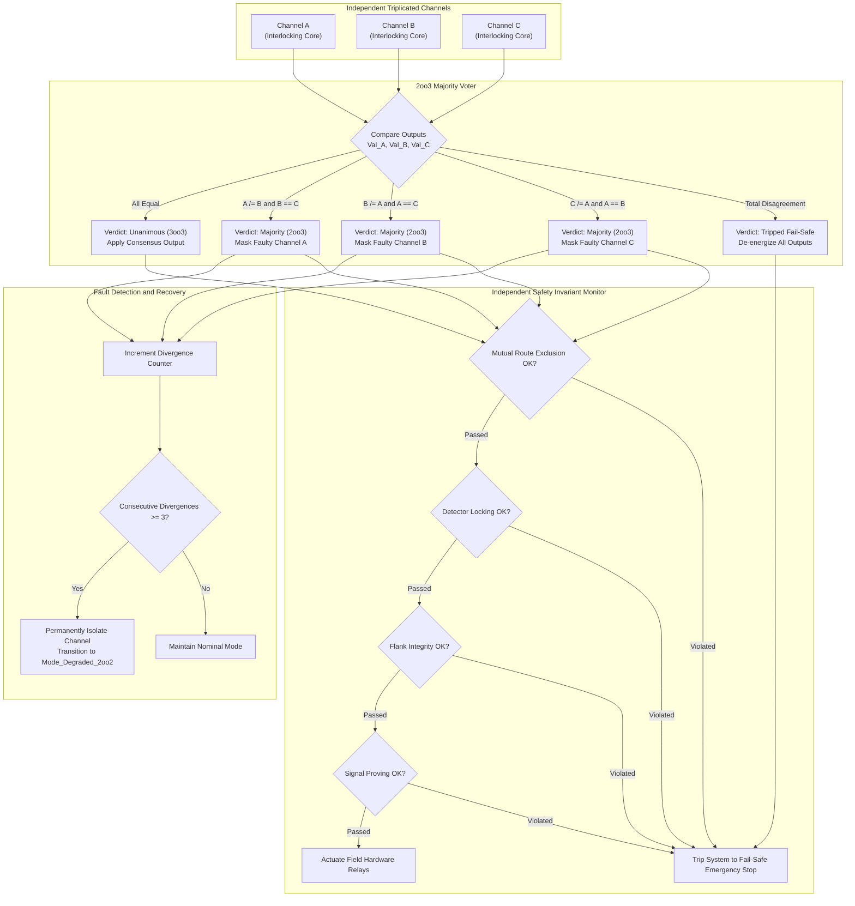
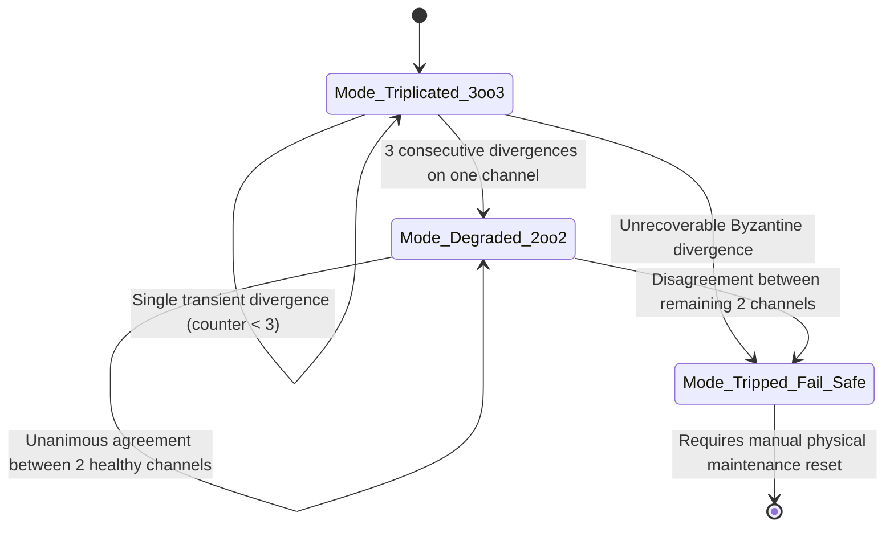
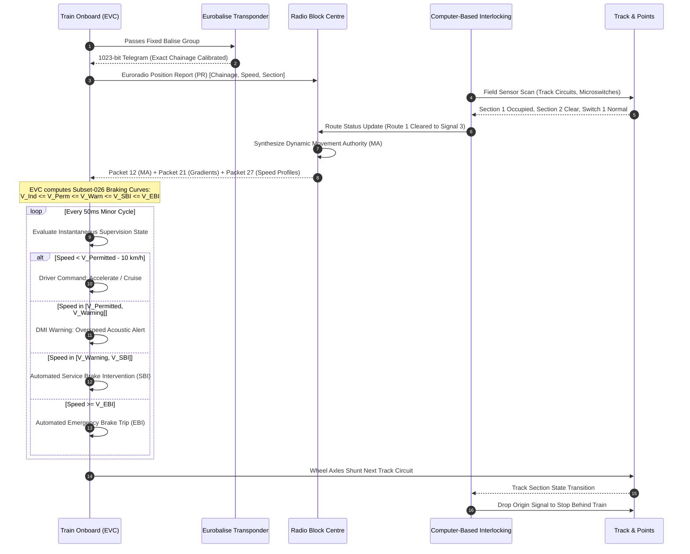
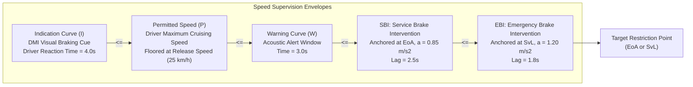
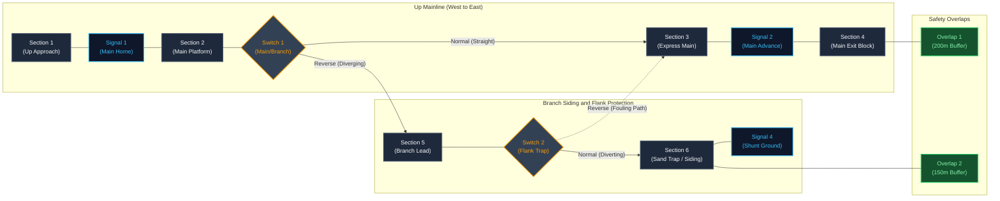
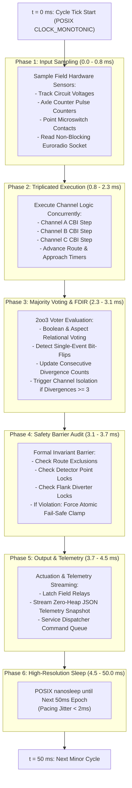

# Aspect Architectural and Process Diagrams

This document contains Mermaid diagrams illustrating the core control flows, state machines, topological schematics, and voting architectures of the Aspect Railway Vital Interlocking and ETCS Level 2 Kernel.

---

## 1. Route Reservation Lifecycle State Machine

This state machine visualizes the complete lifecycle of a railway route from initial dispatcher request through turnout proving, flank lock verification, train passage, and sectional release.

---

## 2. 2oo3 Triple Modular Redundancy (TMR) Voter Pipeline

This flowchart illustrates how independent channel outputs are compared, how Byzantine bit-flip faults are masked, and how degraded modes are triggered.

---

## 3. FDIR Operational Mode Transition State Diagram

---

## 4. ETCS Level 2 Closed-Loop Supervision Sequence

This sequence diagram depicts the interaction between the Simulated Train (EVC), the Radio Block Centre (RBC), and the Computer-Based Interlocking (CBI) during active train control.

---

## 5. ETCS Braking Curve Hierarchy and Supervision Envelopes

---

## 6. Grand Central Junction Track Topology Schematic

This network graph visualizes the physical track configuration of the Grand Central Junction reference scenario (`scenarios/junction.json`).

---

## 7. Hard 50ms Minor Cycle Executive Pipeline

